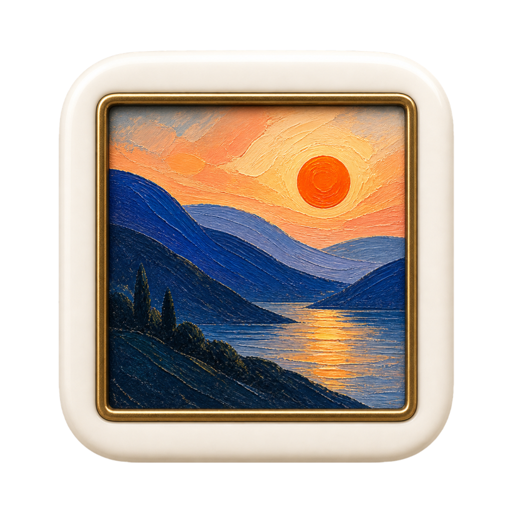
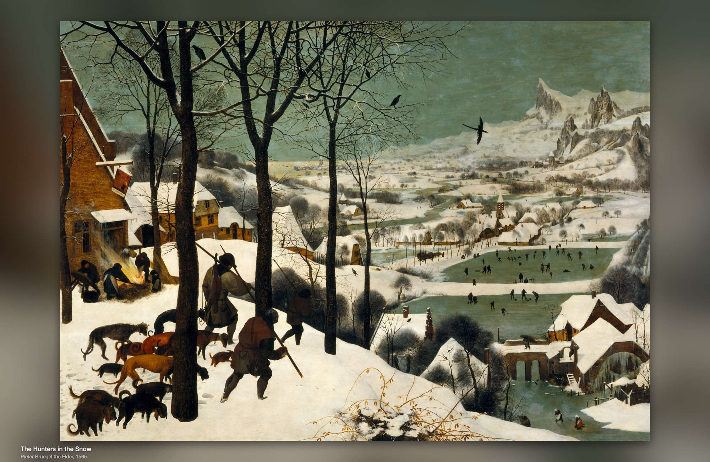
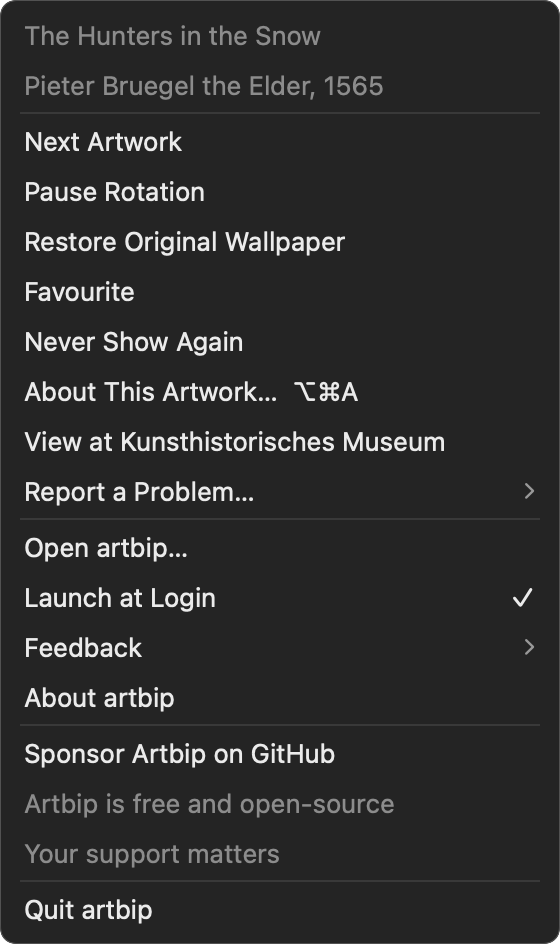
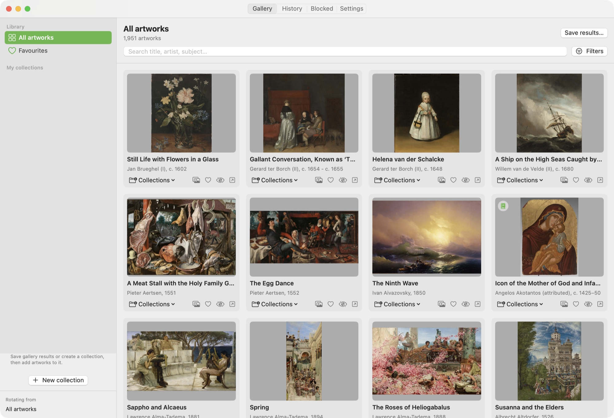
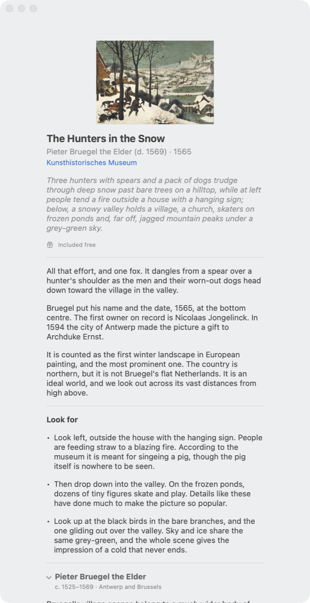

<h1 align="center">
  <br>
  artbip
</h1>

<p align="center">
  <b>A great painting on your Mac desktop, shown whole and changed on your schedule.</b><br>
  2,000+ public-domain works from the world's museums. Free and open source.
</p>

<p align="center">
  <a href="https://github.com/McGinn/artbip/releases/latest"></a>
  
  <a href="LICENSE"></a>
</p>

<p align="center">
  
</p>

artbip is a menu-bar app that sets a painting as your desktop wallpaper and
changes it on a schedule you choose. The collection runs from a Roman wall
painting of about 50 BC to 1943: Song-dynasty landscapes, Bruegel, Vermeer,
Rembrandt, Van Gogh, Klimt and more than 400 artists in all. Each picture is
fitted whole to your screen, with an optional wall label in the corner.

There is no account, no subscription and no analytics.

**[Download the latest release](https://github.com/McGinn/artbip/releases/latest)** · macOS 15 Sequoia or later

## Features

- **The whole painting.** Each work is scaled to fit your
  screen and set on a blurred copy of itself or a flat colour taken from its
  own palette. Margin and background are adjustable. Every display gets its
  own composition at its native resolution.
- **A wall label when you want one.** The title, artist and date in small
  type at the bottom of the screen, like a museum label. Turn it off in
  Settings.
- **Your schedule.** Change the picture every 15 minutes to every 12 hours
  (hourly by default), or once a day, week or month at a time you pick.
- **About This Artwork (⌥⌘A).** A panel with the work's title, artist, date,
  medium, holding collection and a one-line description. For 100 well-known
  works it also has a longer note on the picture, what to look for in it,
  the painter and the period. A link opens the work's page at its museum.
- **A searchable gallery.** Browse the whole collection. Search by title, artist
  or subject, and filter by artist, movement, subject, period, museum, or
  works with notes.
- **Choose what appears.** Favourite works, block any you never want to see
  again, and save any selection as a named collection. Rotate from everything,
  your favourites or one collection. The History tab shows what was on your
  desktop and when.
- **Global shortcuts.** About This Artwork is bound to ⌥⌘A. Shortcuts for
  Next Artwork and Favourite can be set in Settings and work from any app.
- **Works offline.** Downloaded images are cached up to a limit you set
  (2 GB by default). Rotation carries on without a connection once images are
  cached.
- **Your old wallpaper comes back.** Restore Original Wallpaper puts back
  what you had before artbip.
- **A command-line tool.** The same engine is scriptable from Terminal. See
  [Command line](#command-line).

<table>
  <tr>
    <td width="50%" valign="top">
      
    </td>
    <td width="50%" valign="top">
      <p><b>Everything day to day is in the menu bar:</b> next, pause,
      favourite, never show again, restore your original wallpaper, open
      the work's page at its museum, and report a problem with the current
      picture.</p>
      <p>The gallery, history, blocked works and settings live in one
      window, opened from <b>Open artbip…</b></p>
    </td>
  </tr>
</table>

<p align="center">
  
</p>

<table>
  <tr>
    <td width="50%" valign="top">
      <p><b>About This Artwork</b> shows the work's title, artist, date and
      museum, a short description, and for 100 well-known works longer notes
      on the painting, what to look for and, often, the artist.</p>
    </td>
    <td width="50%" valign="top">
      
    </td>
  </tr>
</table>

## Install

1. Download the DMG from the
   [latest release](https://github.com/McGinn/artbip/releases/latest).
2. Open it and drag **artbip** to **Applications**.
3. Open artbip. It appears in the menu bar, not the Dock, and sets the first
   painting straight away.
4. To keep the pictures changing after a restart, turn on **Launch at Login**
   in the menu. It is off until you choose it.

artbip needs **macOS 15 Sequoia or later**. Releases are signed with a
Developer ID and notarized by Apple, so macOS opens them without warnings.

**Uninstall:** quit artbip, choose **Restore Original Wallpaper** first if
you want your old wallpaper back, delete the app, and delete
`~/Library/Application Support/artbip`.

## Privacy

artbip has no account, no analytics, no crash reporting and no tracking, and
there is no artbip server. It downloads artwork images directly from
Wikimedia Commons and the museums' own image servers, and once a day at most
asks GitHub whether a newer version exists (you can turn that off in
Settings). Your favourites, collections, history and settings stay on your
Mac. The details are in [PRIVACY.md](PRIVACY.md).

## Command line

The app bundle includes an `artbip` command. Link it onto your `PATH`:

```sh
mkdir -p ~/.local/bin
ln -s /Applications/artbip.app/Contents/MacOS/artbip ~/.local/bin/artbip
```

(Any folder on your `PATH` will do.)

| Command | What it does |
|---|---|
| `artbip rotate next` | Change the wallpaper now. |
| `artbip rotate current` | Show the work on your desktop. |
| `artbip rotate fav [id]` / `unfav [id]` | Favourite or unfavourite a work (default: the current one). |
| `artbip rotate block [id]` / `unblock <id>` | Never show a work again, or undo that. |
| `artbip rotate pause` / `resume` | Pause or resume scheduled rotation. |
| `artbip rotate restore` | Put back your original wallpaper and pause. |
| `artbip rotate history` | Recently shown works, newest first. |
| `artbip rotate status` | Cache size, queue position, favourite and blocked counts. |
| `artbip info [--id <id>]` | Title, artist, date, medium, collection, source link and caption. |
| `artbip settings` | The settings in effect, including defaults. |
| `artbip update` | Check whether a newer release exists. |

The app and the command share their state, so a favourite made in one shows
up in the other. Scheduled rotation belongs to the app, so keep it running.
`artbip <command> --help` describes every option.

## FAQ

**Is it really free?**
Yes. There is no trial, no account, no in-app purchase and no advertising.
If you want to support it, you can
[sponsor the project on GitHub](https://github.com/sponsors/McGinn).
Sponsoring unlocks nothing; it just says thanks.

**Will artbip ever cost money?**
The app and everything in it today are free and will stay that way. Optional
extra notes may be offered one day; nothing included now will be put behind
a paywall.

**Is it legal to use these images?**
Yes. Every work is either in the public domain or released under CC0 by the
museum that holds it. The collection file records, for each work, where the
image comes from and the evidence for its status, such as the museum's own
public-domain flag or the Wikimedia Commons licence. Works whose US
public-domain status is not established are held back.

**Why is a famous painting missing?**
Usually because the museum hasn't released a good enough image, its US
copyright status is unclear, or it duplicates a version already in the
collection. Suggestions are welcome as a
[feature request](https://github.com/McGinn/artbip/issues/new?template=feature-request.yml).

**Does it work with multiple displays?**
Yes. Each display gets its own composition at its exact resolution.

**What does it cost in battery and disk?**
Very little battery: artbip wakes at your chosen interval, composes one image
per display, sets it and goes idle. Disk use is capped by the download limit
in Settings (512 MB to 8 GB), and **Clear Downloads** empties the cache.

**Is it related to Artpip?**
No. Artpip was a separate app that set fine-art wallpapers and is no longer
available. If you are looking for something that does a similar job,
artbip is one option. It is a separate, unaffiliated project.

**I found a mistake.**
Thank you. Use **Report a Problem…** in the menu while the picture is on your
desktop. It opens a GitHub issue form with the work's details already filled
in; see [Contributing](#contributing).

## Where the art comes from

The images come straight from the open-access programmes of:

- [Wikimedia Commons](https://commons.wikimedia.org/)
- [The Metropolitan Museum of Art](https://www.metmuseum.org/policies/image-resources)
- [National Gallery of Art, Washington](https://www.nga.gov/open-access-images.html)
- [Rijksmuseum](https://www.rijksmuseum.nl/en/research/conduct-research/data)
- [Art Institute of Chicago](https://www.artic.edu/open-access/open-access-images)
- [Cleveland Museum of Art](https://www.clevelandart.org/open-access)

About artbip, in the app, shows how many works come from each.

Wikimedia Commons images are mostly faithful photographs of paintings held by
hundreds of other museums and collections, credited by name in the app. Most
works are in the public domain; the rest are released under CC0.

The collection was drawn from 4,653 high-resolution candidates. Each was rated
for art-historical significance and how well it rewards long viewing;
photographs with visible frames, colour cards or heavy damage were dropped, and
no artist makes up more than 3% of the collection, so the mix stays broad. Titles, artists, dates and
attributions are checked against museum records and published sources. The longer notes cover 100
works by 100 artists, with 89 artist biographies and 18 notes on periods and
schools; every statement in them is checked against a museum record or a
published source.

Thank you to these institutions and to the Wikimedia community for making
their collections free to use. Museum names are used only to say where an
image comes from; no museum endorses artbip.

## Contributing

- **Report a problem with a picture or its text.** In the app, choose
  **Report a Problem…** from the menu. It opens a pre-filled GitHub issue
  form; nothing is sent until you submit it. You can also open one directly:
  [problem with an artwork](https://github.com/McGinn/artbip/issues/new?template=bad-artwork.yml)
  (wrong artist, poor scan, not public domain, duplicate) or
  [problem with the info text](https://github.com/McGinn/artbip/issues/new?template=bad-info.yml).
  A link to the museum's own page, or a book that says otherwise, helps most.
- **Suggest a feature** with the
  [feature request form](https://github.com/McGinn/artbip/issues/new?template=feature-request.yml).
- **Code:** pull requests are welcome. For anything larger than a fix, open
  an issue first so we can agree on the approach.
- **Collection data:** please propose changes to works, captions or
  attributions as issues rather than pull requests against `data/`. The
  collection is maintained by targeted, source-checked corrections.

## Build from source

You need macOS 15 or later and a Swift 6.1 toolchain (Xcode, or the Command
Line Tools).

```sh
git clone https://github.com/McGinn/artbip.git && cd artbip
bash scripts/make_app.sh        # builds dist/artbip.app (ad-hoc signed)
open dist/artbip.app
```

- `bash scripts/swift_build.sh` builds for development. It picks a macOS SDK
  that matches your compiler; set `ARTBIP_SDKROOT` to override.
- `bash scripts/swift_build.sh --test` runs the Swift tests. They use
  temporary state and simulated wallpaper and network calls, so they never
  touch your desktop.
- `(cd scripts && python3 -m unittest)` runs the data checks.
- `nix run .#build` also works if you use Nix.

To try a build without disturbing an installed copy, give it a throwaway
state folder:

```sh
ARTBIP_RUNTIME_DIR=$(mktemp -d) dist/artbip.app/Contents/MacOS/ArtbipApp --show-gallery
```

From the repository folder, `artbip compose` renders a single wallpaper to
a PNG without changing your desktop:

```sh
dist/artbip.app/Contents/MacOS/artbip compose --id wikidata-Q500985 --background palette --label --out hunters.png
```

[docs/architecture.md](docs/architecture.md) explains how the pieces fit
together.

## Licence

| What | Licence |
|---|---|
| Source code | [MIT](LICENSE) |
| Artwork images | Public domain or CC0, per work. The source and evidence for each are in `data/manifest.json`. |
| Collection data (`data/manifest.json`, `data/scores.json`, `data/overrides.json`, `data/curate.json`, `data/withheld-works.json`), including the one-line captions | [CC0 1.0](https://creativecommons.org/publicdomain/zero/1.0/) |
| Notes on works, artists and periods (`data/education/starter.json`) | © Alexander McGinn, all rights reserved. Licensed for reading in artbip only. |
| The name "artbip" and its icon | Not licensed for reuse. |

See [LICENSE](LICENSE) for the full terms.
